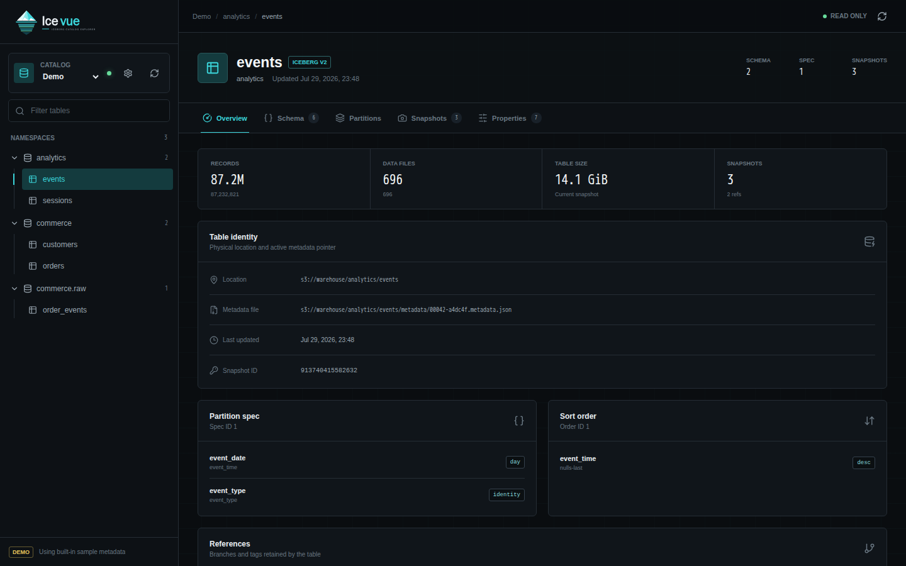
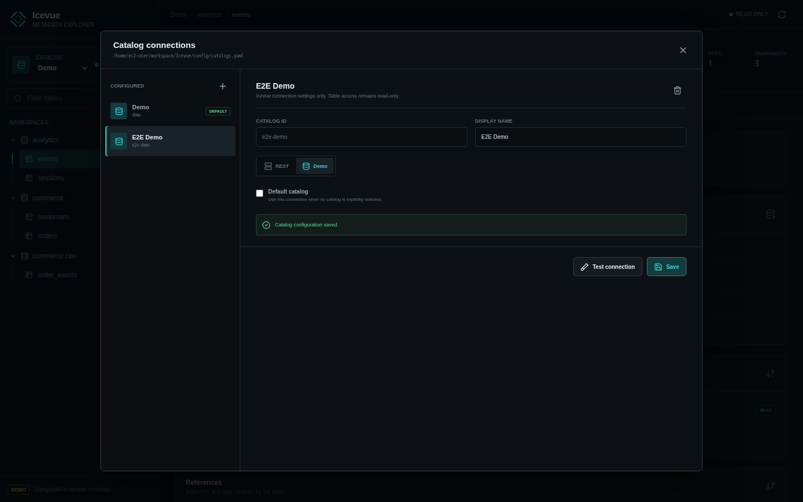

# Icevue

<p align="center">
  <picture>
    <source media="(prefers-color-scheme: dark)" srcset="docs/icevue-logo-dark.svg">
    <source media="(prefers-color-scheme: light)" srcset="docs/icevue-logo-light.svg">
    
  </picture>
</p>

[](https://github.com/norrishuang/Icevue/actions/workflows/ci.yml)
[](LICENSE)
[](https://www.python.org/)
[](https://py.iceberg.apache.org/)
[](docs/DEPLOYMENT.md)

Icevue is a lightweight, read-only web interface for exploring Apache Iceberg
REST catalogs. It makes namespaces, tables, schemas, partition metadata,
snapshots, sort orders, references, and table properties available in one
focused workspace.



Catalog settings are available from the settings icon beside the Catalog
selector:



## Why Icevue

Iceberg metadata is rich, but it is usually inspected through SQL engines,
command-line tools, or raw metadata files. Icevue uses PyIceberg directly and
does not require Spark, Trino, Flink, or another query engine.

The first release provides:

- Searchable namespace and table navigation
- Multiple REST Catalog connections with an in-app switcher
- File-backed catalog configuration with connection testing
- Current and historical schemas
- Partition specs and a filterable, paginated partition list
- Snapshot history and summary statistics
- Sort orders, branches, tags, and table properties
- A read-only FastAPI backend with OpenAPI documentation
- A built-in demo catalog for evaluation
- A production-ready single-container image

## Quick start

Run the complete application with sample metadata:

```bash
docker compose up --build
```

Open `http://localhost:8000`.

Click the settings icon beside the Catalog selector to add a REST Catalog,
test the connection, and save it. Catalog connections are persisted in
`/app/config/catalogs.yaml` inside the `icevue-config` Docker volume.

To seed the first Catalog from environment variables instead:

```bash
cp .env.example .env
```

Update `.env`:

```env
ICEVUE_DEMO_MODE=false
ICEVUE_CATALOG_NAME=production
ICEVUE_CATALOG_URI=http://iceberg-rest:8181
ICEVUE_CATALOG_WAREHOUSE=s3://my-warehouse/
```

These legacy variables are imported only when `catalogs.yaml` does not exist.
After the first start, use the UI or edit the YAML file.

## Catalog configuration

Icevue stores multiple connections in one YAML file:

```yaml
version: 1
default_catalog: production
catalogs:
  - id: production
    name: Production
    type: rest
    uri: http://iceberg-rest:8181
    warehouse: s3://my-warehouse/
    properties:
      s3.region: us-east-1
  - id: demo
    name: Demo
    type: demo
```

See [catalogs.example.yaml](config/catalogs.example.yaml) for a complete
starting point. The backend writes updates atomically and sets the file mode
to `0600`. Tokens and client credentials are stored in this file but are
never returned by the API.

## Configuration

| Variable | Required | Description |
| --- | --- | --- |
| `ICEVUE_CATALOG_CONFIG` | No | YAML path; defaults to `config/catalogs.yaml` |
| `ICEVUE_DEMO_MODE` | No | Legacy bootstrap setting |
| `ICEVUE_CATALOG_NAME` | No | Legacy bootstrap catalog ID |
| `ICEVUE_CATALOG_URI` | No | Legacy bootstrap REST Catalog URI |
| `ICEVUE_CATALOG_WAREHOUSE` | No | Legacy bootstrap warehouse |
| `ICEVUE_CATALOG_TOKEN` | No | Legacy bootstrap bearer token |
| `ICEVUE_CATALOG_CREDENTIAL` | No | Legacy bootstrap OAuth2 credential |
| `ICEVUE_CATALOG_PROPERTIES` | No | Legacy bootstrap properties as JSON |
| `ICEVUE_MAX_PARTITION_PAGE_SIZE` | No | Maximum API page size; defaults to `250` |

See [Deployment](docs/DEPLOYMENT.md) for authentication examples and
production guidance. See [Architecture](docs/ARCHITECTURE.md) for the API,
security boundary, and metadata behavior.

## Contributing

Bug reports, pull requests, documentation improvements, Catalog compatibility
findings, and early-stage ideas are welcome. See
[Contributing](CONTRIBUTING.md) for development setup, project principles, and
submission guidance.

## Development

Requirements:

- Python 3.11 or newer
- Node.js 20 or newer

Start the backend:

```bash
python3 -m venv .venv
.venv/bin/pip install -e ".[dev]"
ICEVUE_DEMO_MODE=true .venv/bin/uvicorn icevue.main:app --reload
```

Start the frontend in another terminal:

```bash
cd frontend
npm install
npm run dev
```

Run checks:

```bash
.venv/bin/ruff check .
.venv/bin/pytest
cd frontend && npm run build
```

## Scope

Icevue never modifies Iceberg catalogs, tables, snapshots, properties,
schemas, partitions, or table records. The Catalog settings UI writes only
Icevue's local connection file.

## License

[MIT](LICENSE)
